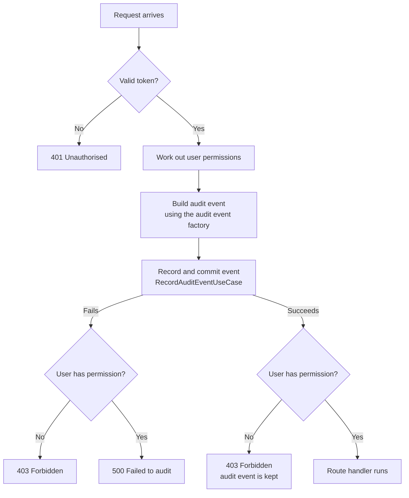

# Audit and permission checks

This guide explains how an endpoint records an audit event and then checks the
caller's permission, and how to apply the same behaviour to another endpoint.

## Background: FastAPI dependencies

A FastAPI _dependency_ is a function (or callable object) that FastAPI runs
**before** your route handler. If a dependency raises an `HTTPException`, FastAPI
returns that error immediately and the route handler never runs.

Routes list dependencies in `dependencies=[Depends(...)]`. Here the dependency is
an `AuditedPermissionChecker` object. FastAPI calls it for every request, and
inspects the parameters of its `__call__` method to supply values such as the
database session and the current user's permissions.

## What it does

For every authenticated request, the dependency:

1. Records an audit event, **even if the user is not allowed to proceed**.
2. Then checks the user holds the required permission.

The audit comes first so that denied attempts are still on record. If the audit
cannot be recorded, the request is blocked.

## Execution order



In words:

1. **Authentication.** FastAPI first resolves the dependencies of
   `AuditedPermissionChecker` (token validation, permissions, database session).
   An invalid or missing token returns 401 and nothing is audited.
2. **Build the event.** The route's audit event factory turns the user's email
   address and the request into an audit event object.
3. **Record the event.** `RecordAuditEventUseCase` writes the event and commits it.
   If the write fails, it rolls back and raises an error.
4. **Check permission.** The permission check runs last, after the audit.
5. **Route handler.** Only runs if every step above succeeded.

## Outcomes

| Permission | Audit    | Response                                 |
| ---------- | -------- | ---------------------------------------- |
| Granted    | Succeeds | Route handler runs (for example, 200)    |
| Denied     | Succeeds | 403; audit event is kept                 |
| Granted    | Fails    | 500; route handler does not run          |
| Denied     | Fails    | 403; route handler does not run          |

"Fails" covers any problem setting up, writing or committing the audit. A denied
user always receives 403, so a broken audit never reveals that the resource exists.
Audit failures are logged without user details or tokens.

## The parts

| Part                                                                                             | Responsibility                                                                |
| ------------------------------------------------------------------------------------------------ | ----------------------------------------------------------------------------- |
| [`audited_permission_checker.py`](./audited_permission_checker.py)                               | The dependency. Controls the order above and translates failures into 403/500. |
| [`report_audit_event_factory.py`](./report_audit_event_factory.py)                               | Builds a `ReportAudit` event for report endpoints.                            |
| [`view_application_audit_event_factory.py`](./view_application_audit_event_factory.py)           | Builds a `ViewApplicationAudit` event for an application page.                |
| [`record_audit_event.py`](../../use_cases/audit/record_audit_event.py)                           | The use case. Writes and commits the event, and rolls back on failure.        |

The factories only translate the request into an event. They contain no database
code and no business rules.

## Adding it to an endpoint

Add `audit_and_require_permission` to the route's `dependencies`, with the
required permission and an event factory:

```python
@router.get(
    "/claims/backlog",
    dependencies=[
        Depends(
            audit_and_require_permission(
                possible_permissions=Permission.REPORTS_CLAIM_WORKFLOW_READ,
                audit_event_factory=ReportAuditEventFactory(
                    report_type=ReportType.CLAIMS_BACKLOG
                ),
            )
        ),
    ],
)
def get_claim_backlog_report(...):
    ...
```

Do not also add `require_permission_from(...)` to the same route. The audited
dependency already enforces the permission.

## Auditing a new kind of event

1. Add a table model for the event in `app/models/audit/index.py` (it must extend
   `BaseAuditEvent`) and generate an Alembic migration.
2. Add a factory in this folder: a callable taking `(user_email_address, request)`
   and returning the event. Use the existing factories as a template.
3. Pass the factory to `audit_and_require_permission` on the route.
4. Add a unit test for the factory, and add the route to the route map in
   `tests/unit/auth/test_route_permissions.py`.
5. Cover the outcomes in the table above with an end-to-end test. See
   `tests/e2e/auth/test_audit_get_application.py` for a template.

## Things to be aware of

- The dependency creates the audit repository itself (rather than receiving it
  through `Depends`) so that setup errors are handled in the same way as write
  errors.
- The audit use case performs blocking database work, so it runs in a thread pool
  to avoid blocking the event loop.
- Request-specific rules (for example, which query parameters to record) belong in
  the factory. Rules that apply to every event, such as requiring a user email
  address, belong in `RecordAuditEventUseCase`.
